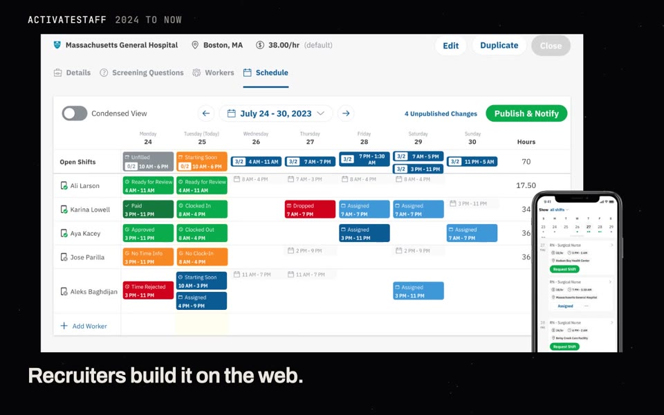
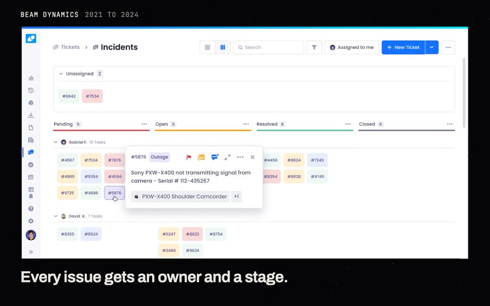

<a href="https://gmoreira.dev">
  <picture>
    <source media="(prefers-color-scheme: dark)" srcset="assets/header-dark.svg">
    
  </picture>
</a>

I build web and mobile products end to end, from the data model to the last pixel. Today I lead the frontend at ActivateStaff ([@TimeSaved](https://github.com/TimeSaved)), with the web app and the iOS and Android apps in my hands. Before that I spent two and a half years building the React app TV studios use at Beam Dynamics.

I left dentistry school for software, and I have shipped products for teams in the US and Canada since 2021.

### Selected work

  
  

- **[ActivateStaff](https://gmoreira.dev/work/activate-staff/)** · Lead frontend engineer · 2024 to now Scheduling, timekeeping and invoicing for staffing agencies, on web, iOS and Android.
- **[Beam Dynamics](https://gmoreira.dev/work/beam-dynamics/)** · Full-stack, frontend focus · 2021 to 2024 The asset management app TV studios run on: data tables, real-time dashboards, ticketing.
- **[WYND](https://gmoreira.dev/work/wynd/)** · React Native engineer · 2021 Two React Native apps launched in six months: a telecom customer app and a money transfer app.

**Stack** &nbsp; TypeScript · React · React Native · Next.js · Node.js · Tailwind CSS · Redux · React Query

Everything else I have shipped with

 
Expo, Vite, styled-components, Cypress, Auth0, Mixpanel, Docker, GitHub Actions, Three.js, Mantine, Apollo GraphQL

  <samp>
    <a href="https://gmoreira.dev">gmoreira.dev</a>
    &nbsp;·&nbsp;
    <a href="https://www.linkedin.com/in/guilherme-moreira-costa">LinkedIn</a>
    &nbsp;·&nbsp;
    <a href="mailto:gmoreira.costa.dev@gmail.com">gmoreira.costa.dev@gmail.com</a>
  </samp>

